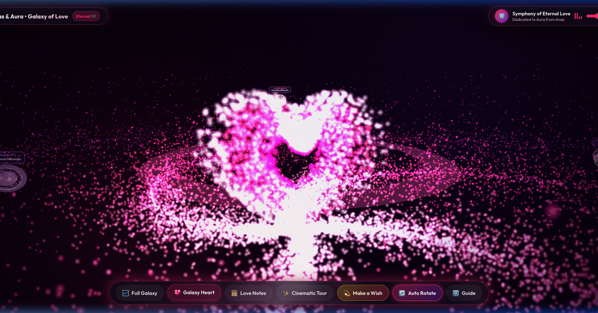

# ✨ Galaxy of Love • Anas & Aura ✨

> *"In this boundless cosmos, every star illuminates the sky.. but you alone light up my entire universe."*  
> *"في هذا الفضاء الكوني الواسع، كل النجوم تُضيء السماء.. ولكنكِ وحدكِ من يُضيء روحي وقلبي."*



A breathtaking interactive 3D **Galaxy of Love** built with modern web technologies and **Three.js**. Dedicated with eternal love, devotion, and adoration from **Anas** to his love, **Aura**. Featuring over 26,000 sparkling pink & magenta star particles, a pulsing 3D cosmic heart at the core, and orbiting romantic love notes floating through deep space.

---

## 🌟 Features • مميزات المجرة

- **🌌 3D Spiral Love Galaxy:** Over 26,000 custom-shaded particle stars, glowing nebula dust, and celestial cosmic dust in radiant neon pink, magenta, and deep violet.
- **💖 Pulsing Cosmic Core Heart:** A 3D particle heart pulsing with life and warmth at the very center of the galaxy.
- **📜 Orbiting Love Letters:** 3D interactive floating notes orbiting the galactic core carrying heartfelt messages from Anas to Aura.
- **🖼️ Celestial Memory Constellations:** 8 interactive memory waypoints illustrated with romantic vector art and custom photo upload capability.
- **💫 Make a Cosmic Wish:** An interactive stargazing modal where Aura can write a wish and watch it shoot across the galaxy as a brilliant glowing shooting star.
- **🎵 Romantic Symphony & Audio Visualizer:** High-fidelity ambient romantic piano with responsive frequency visualizer and custom music upload.
- **📱 100% Responsive & Cross-Device Compatible:** Flawless 60fps performance across iOS, Android, tablets, and high-resolution 4K desktops.

---

## 🚀 Instant Deployment (Vercel / GitHub Pages)

This project is built with vanilla **HTML5, CSS3, modern JavaScript, and Three.js** — zero build step required.

1. **Deploy to Vercel:**
   - Go to [vercel.com](https://vercel.com)
   - Click **Add New Project** and import `670q/aura`
   - Click **Deploy** (auto-detected as static site with included `vercel.json`)

2. **Run Locally:**
   ```bash
   npx serve .
   # or
   python3 -m http.server 8080
   ```

---

<p align="center">
  <b>Crafted with Eternal Love &amp; Devotion • Anas ❤️ Aura</b>
</p>
